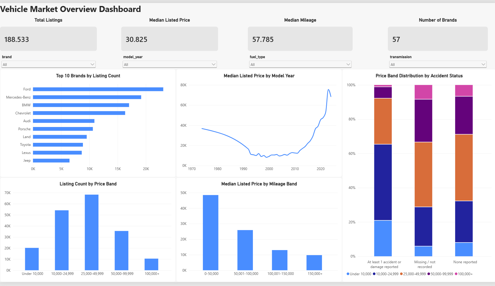
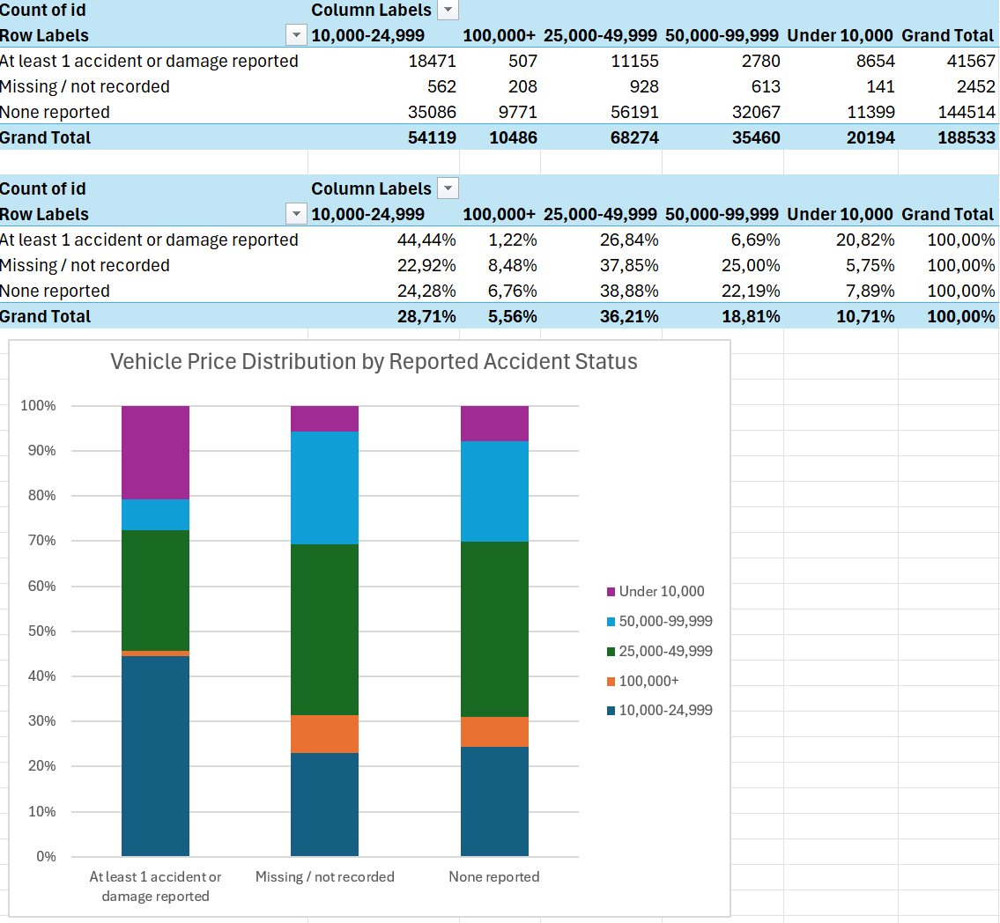
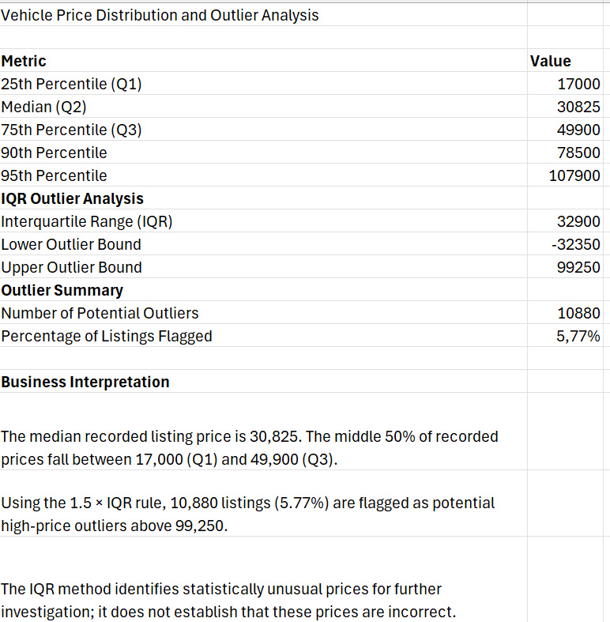

# Vehicle Market Analytics

## Project Overview

This project analyses a used-car listing dataset using SQL Server, Python, Excel, and Power BI.

The objective is to examine vehicle listing prices, compare brand and model listing volumes, explore vehicle characteristics, and assess data quality to support used-vehicle market analysis and reporting.

The project combines SQL-based business analysis, Python data cleaning and exploratory data analysis, Excel statistical analysis, and an interactive Power BI dashboard.

---

## Business Problem

Vehicle marketplaces, dealers, and exporters need to understand the composition and pricing patterns of vehicle listings to support market research and reporting.

This project investigates four key areas:

- **Brand and model representation:** Which vehicle brands and models have the highest listing volumes, and how do their recorded prices differ?
- **Vehicle pricing patterns:** How do advertised prices vary across brands, model years, mileage ranges, fuel types, and price bands?
- **Vehicle characteristics:** How are listings distributed by mileage, fuel type, transmission, accident status, and clean-title information?
- **Data quality and reporting reliability:** How do missing values, inconsistent categorical entries, and unusually high listed prices affect data interpretation and reporting?

The analysis focuses on recorded vehicle listings. Listing volumes do not establish actual buyer demand or sales performance, and advertised prices are not confirmed selling prices.

---

## Dataset

**Source:** [Kaggle — Used Cars Dataset](https://www.kaggle.com/datasets/mohamedesam10/used-cars-dataset)

**Dataset size:** 188,533 vehicle records

Key fields include:

- Brand
- Model
- Model Year
- Mileage
- Fuel Type
- Engine
- Transmission
- Accident Status
- Clean Title
- Price

**Dataset limitation:** The currency used for vehicle prices is not specified. All price-related analysis therefore uses the reported values without applying currency conversion.

---

## Tools Used

- **SQL Server and SQL Server Management Studio (SSMS):** Data queries and business analysis
- **Python (Pandas, NumPy, Matplotlib):** Data cleaning, profiling, and exploratory data analysis
- **Microsoft Excel:** PivotTables, statistical summaries, and potential outlier assessment
- **Microsoft Power BI:** Interactive dashboard development
- **Git and GitHub:** Version control and project documentation

---

## Project Workflow

### 1. Data Acquisition

- Obtained the used-car dataset from Kaggle.
- Imported the data into SQL Server for analysis.

### 2. Data Quality Assessment

- Validated dataset row counts.
- Assessed missing values across key fields.
- Checked for duplicate records and IDs.
- Profiled data distributions and investigated unusually high recorded prices.

### 3. SQL Business Analysis

- Analysed listing volumes by brand and brand–model combination.
- Compared average recorded prices across brands and models.
- Examined pricing patterns across model years and mileage ranges.
- Investigated vehicle age and mileage characteristics.

### 4. Data Cleaning and Transformation

- Standardised inconsistent categorical values.
- Assessed and handled missing values.
- Checked for duplicate records and IDs.
- Prepared a cleaned dataset for further analysis.

### 5. Python Exploratory Data Analysis

- Examined price distributions using the mean, median, and percentiles.
- Investigated extreme recorded prices and assessed their influence on summary statistics.
- Compared mean and median prices across mileage groups and brands.
- Analysed recorded prices and mileage by fuel type.
- Used visualisations to explore price distributions and potential anomalies.

### 6. Excel Analysis

- Compared price-band distributions across accident-status groups using PivotTables and a 100% stacked column chart.
- Summarised price distributions using statistical formulas.
- Applied the interquartile range (IQR) method to flag potential price outliers for further review.

### 7. Power BI Dashboard

Created a single-page interactive dashboard to explore vehicle listings, pricing patterns, and vehicle characteristics.

The dashboard includes:

- KPI cards for total listings, median listed price, median mileage, and number of brands.
- Top 10 brands by listing count.
- Listing count by price band.
- Median listed price by model year.
- Median listed price by mileage band.
- Price-band distribution by accident status.
- Interactive filters for brand, model year, fuel type, and transmission.

### Power BI Dashboard Preview



---

## Excel Analysis Previews

### Price-Band Distribution by Accident Status

A PivotTable and 100% stacked column chart compare the distribution of listing price bands across recorded accident-status groups.



### Statistical Analysis and Potential Outliers

Descriptive statistics and the IQR method help assess the spread of recorded prices and identify observations for further investigation.



---

## Key Findings

- **Listing representation:** Ford has the highest listing volume in the dataset. Listing counts describe the dataset's composition rather than actual market demand.
- **Price distribution:** The median listed price is 30,825, compared with a mean of approximately 43,878. The difference indicates that the distribution is influenced by higher-priced listings.
- **Mileage and price:** Listings in lower-mileage bands generally have higher median listed prices than listings in higher-mileage bands.
- **Vehicle age:** Older vehicles generally show higher mileage and lower average listed prices, although prices also vary across model years and the number of listings differs considerably between years.
- **Potential price anomalies:** Extremely high recorded prices were investigated because they can influence averages and visualisations. Repeated high values warrant further review but do not, by themselves, prove that the records are incorrect.

These findings describe patterns in the available dataset and should not be interpreted as evidence of causation, confirmed selling prices, or profitability.

---

## Limitations

- **Currency:** The dataset does not specify the currency used for vehicle prices. Reported prices are analysed without currency conversion.
- **Listing prices:** Prices represent recorded advertised prices, not confirmed selling prices.
- **Market trends:** The dataset does not provide historical listing dates or snapshots, so it cannot establish changes in market prices over time.
- **Demand and performance:** Listing counts indicate the representation of brands and models in the dataset, not actual buyer demand, sales performance, or profitability.
- **Data completeness:** Missing accident or clean-title information indicates that the relevant information was not recorded; it does not establish a negative vehicle history.
- **Unusual prices:** Extremely high recorded prices were flagged for further investigation but have not been confirmed as data errors. No records were removed solely because of these unusually high prices.

---

## Project Structure

```text
Vehicle-Market-Analytics/
├── Data/
├── SQL/
├── Python/
├── Excel/
│   └── Vehicle_Market_Analysis.xlsx
├── PowerBI/
│   └── Vehicle_Market_Overview.pbix
├── Docs/
├── Images/
│   ├── excel_pivot_table_analysis.png
│   ├── excel_statistical_analysis.png
│   └── powerbi_dashboard.png
└── README.md
```

